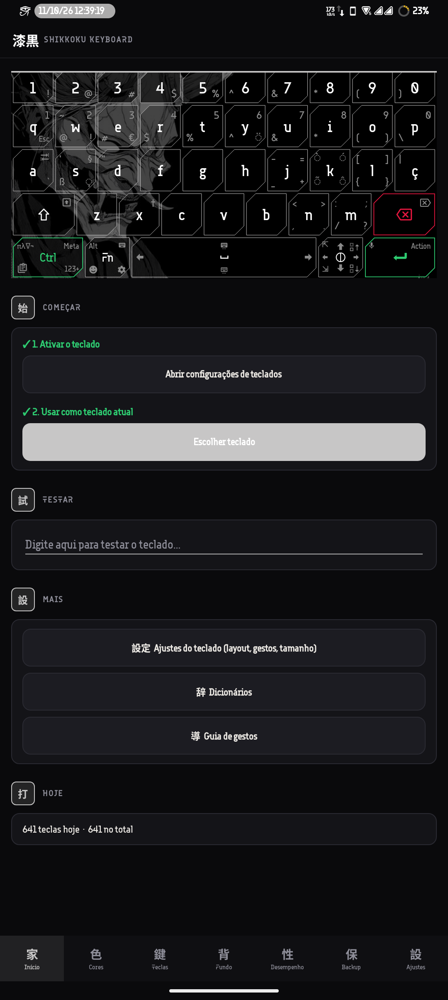
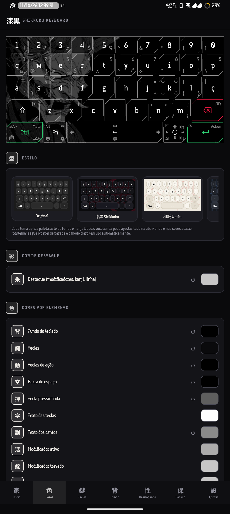
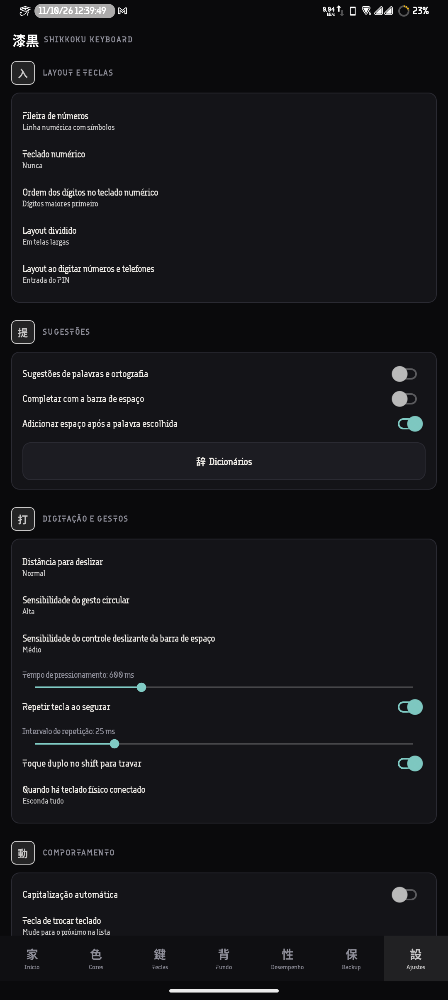
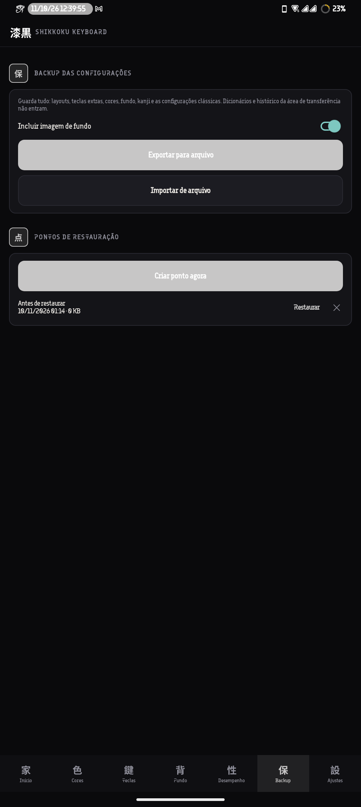
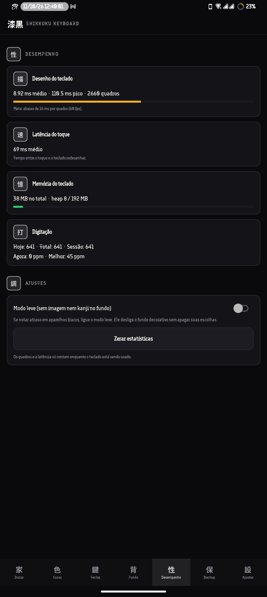
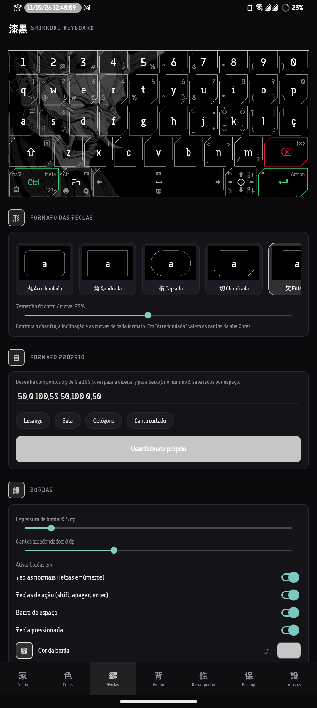

<div align="center">

# 漆 Shikkoku Keyboard

**Um teclado Android totalmente personalizável, com estética japonesa escura.**

Baseado no [Unexpected Keyboard](https://github.com/Julow/Unexpected-Keyboard) · GPL-3.0

</div>

---

## Sobre

O Shikkoku Keyboard é uma versão do Unexpected Keyboard 2.2.0 com um estúdio visual completo dentro do próprio app. Tudo o que antes ficava espalhado nas configurações clássicas agora está em abas, num visual único (cartões, sliders e listas no estilo SHIKKOKU).

## Recursos

- **Temas prontos**: Shikkoku, Washi, Sumi, Cyberpunk, Synthwave, Matrix, Sakura, Oceano, Brasa e Sistema (cores dinâmicas do Material You no Android 12+).
- **Meu teclado**: guarda o seu visual (cores, bordas, teclas e fundo). Ao trocar de tema ele é salvo sozinho e você volta a ele com um toque.
- **Cores por elemento**: fundo, teclas, teclas de ação, barra de espaço, tecla pressionada, textos, modificadores e bordas.
- **Teclas individuais**: fundo, texto, cor e espessura da borda de cada tecla.
- **Bordas, cantos e formato** das teclas, com interruptores por tipo de tecla.
- **Fundo**: arte, imagem própria e kanji, com opacidade e brilho. Dá para desligar tudo e ficar com cor lisa.
- **Prévia fiel** no topo: desenha o seu teclado de verdade, com layout, margens, altura e cores aplicadas.
- **Ajustes nativos**: layouts, teclas extras, sugestões, digitação, gestos, comportamento e área de transferência.
- **Desempenho**: estatísticas de uso do teclado.
- **Backup e restauração** das configurações em JSON, com a imagem de fundo opcional.
- **Aba Sobre** com informações do projeto e links.

## Capturas de tela

<p align="center">
  
  
  
</p>
<p align="center">
  
  
  
</p>

## Abas do app

| Aba | O que tem |
|---|---|
| 家 Início | Ativar o teclado, testar e atalhos |
| 色 Cores | Temas, Meu teclado, cores e teclas individuais |
| 鍵 Teclas | Tamanho, espaçamento, opacidade, brilho e bordas |
| 背 Fundo | Arte, imagem e kanji |
| 性 Perf. | Desempenho |
| 保 Backup | Exportar e restaurar |
| 設 Ajustes | Layouts, teclas extras, gestos e comportamento |
| 我 Sobre | Versão, licença e links |

## Compilar

Requisitos: JDK 17 ou superior e o Android SDK.

```bash
git clone https://github.com/xkzetsu2/shikkokukeyboard
cd shikkokukeyboard
./gradlew assembleFast
```

O APK sai em `build/outputs/apk/`.

## Instalar e usar

1. Instale o APK.
2. Abra o app e, na aba **Início**, ative o teclado.
3. Escolha o Shikkoku Keyboard como teclado atual.
4. Personalize nas abas **Cores**, **Teclas** e **Fundo**.

## Autor

**João** · [@xkzetsu2](https://github.com/xkzetsu2)

## Créditos e licença

Este projeto é um fork do [Unexpected Keyboard](https://github.com/Julow/Unexpected-Keyboard), criado por Julow e colaboradores. É distribuído sob a licença **GNU GPL v3**. Veja o arquivo [LICENSE](LICENSE).
